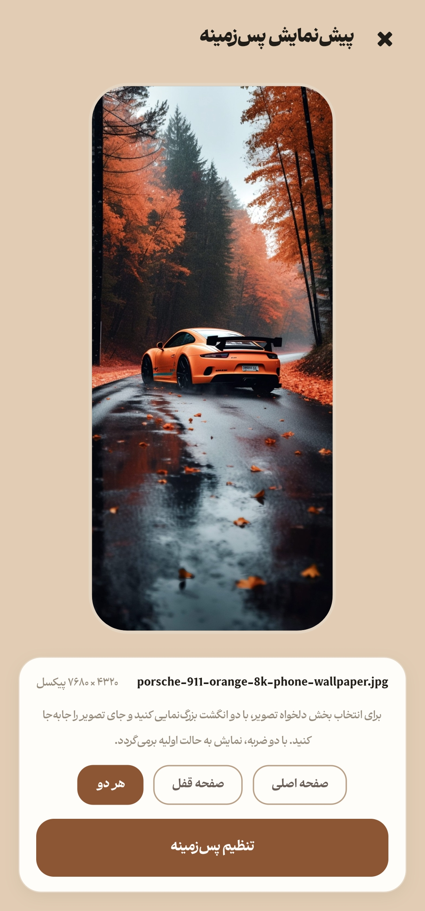
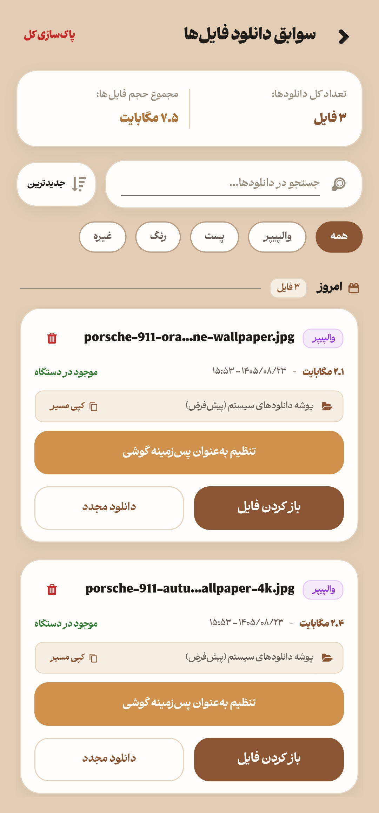
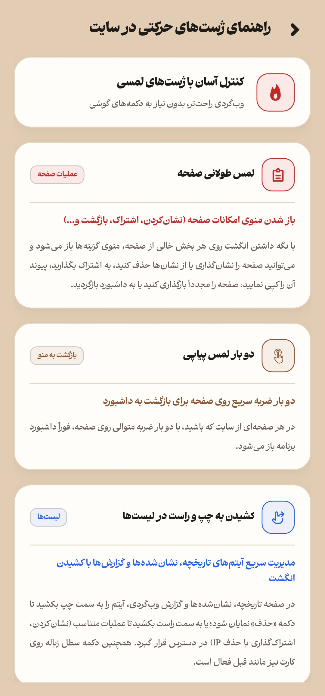
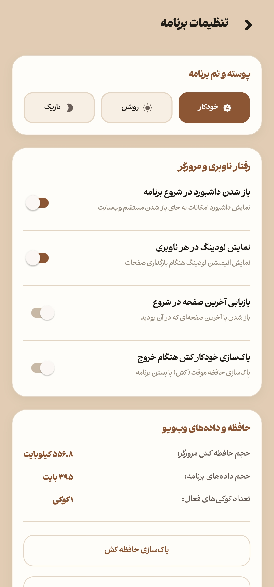
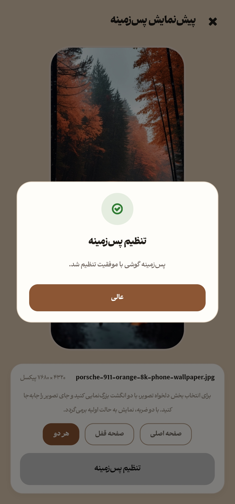

<div align="center">


# KopolArt for Android

**Colors, palettes, wallpapers and articles from [kopolart.ir](https://kopolart.ir) — in a fast, native-feeling Persian app.**


[**Download the APK**](https://github.com/kopolart/kopolart-android/releases/latest) ·
[Website](https://kopolart.ir) ·
[Report a bug](https://github.com/kopolart/kopolart-android/issues)

</div>

---

## Screenshots

| Dashboard | Wallpaper preview | Downloads | Gesture guide |
| :---: | :---: | :---: | :---: |
|  |  |  |  |
| A live dashboard with quick access, online users, traffic and session stats | Crop for home screen, lock screen or both, then apply instantly | Every file you saved, with size, path, re-download and set-as-wallpaper actions | Long-press actions, double-tap to return, swipe to manage lists |

<details>
<summary><b>More screenshots</b></summary>
<br />

| | | | |
| :---: | :---: | :---: | :---: |
|  |  |  |  |

</details>

## What is this?

KopolArt is a Persian platform for graphic design, programming and visual creativity. This repository is the **Android client** — a native shell built with .NET MAUI around the KopolArt experience, designed so the site feels like an app rather than a page in a mobile browser.

The client is not a thin browser tab. It brings its own dashboard, library, download manager, offline reader, wallpaper engine, widgets and update pipeline, and talks to `kopolart.ir` for content.

> This repository contains the **client only**. The website, backend, APIs, artwork, photography and written content are not part of this project and are not licensed here.

## Features

KopolArt for Android is a complete client, not a browser in disguise. Everything listed here is implemented natively around the site.

| Area | Highlights |
| --- | --- |
| **Dashboard** | Native home screen, quick access, live session metrics, milestones and achievements |
| **Browser** | Hardware-accelerated WebView, in-page find, image actions, native sharing, predictable back |
| **Library** | Bookmarks, history, download manager with pause/resume, offline pages |
| **Wallpapers** | Preview, crop for home / lock / both, apply without leaving the app |
| **Updates** | In-app updater with changelog, progress notifications and update history |
| **Data** | Portable backup and restore, storage controls, on-device analytics |

### Dashboard — the app opens like an app

- **Native dashboard** with quick access to colors, palettes, posts, wallpapers and tools, so launching the app no longer drops you into a browser page.
- **Live session card**: pages visited, time on site, network traffic and the number of users online right now.
- **Milestones and achievements** that track steady use, plus a full usage page with the detail behind them.
- **Smart search** across posts, colors, palettes and wallpapers, with suggestions while you type and recent searches as one-tap chips.
- **Profile card** with a greeting and a direct login entry point when you are signed out.
- **First-run onboarding** with a short tour and a notification-permission step, plus a built-in **gesture guide** (long-press, double-tap, swipe).

### Browser — the whole site, with app behaviour

- The full KopolArt experience inside a **hardware-accelerated WebView** with a persistent, signed-in session.
- **Find in page** with match counter, next / previous navigation and highlighted results.
- **Image long-press actions** — save or download an image without leaving the page.
- **Blob downloads** through a dedicated JS bridge, so canvas- and blob-generated files download like any other file.
- **Native sharing** in both directions: the site can hand content to the Android share sheet (`kopolart-share:`), and links can be shared out with the standard picker.
- **Predictable back navigation** — the back button walks page history first and only then offers to leave the app.
- **Themed offline page** and retry handling when the connection drops; external links open in the system browser while trusted KopolArt hosts stay in-app.
- **Loading animation** on every navigation, with a setting to turn it off.

### Library — everything you saved, in one place

- **Bookmarks** with inline editing and quick removal.
- **History**, grouped by day, searchable, with swipe-to-delete and per-item actions.
- **Download manager** with live progress notifications, **pause / resume / cancel**, a configurable destination folder and an optional "ask where to save" prompt.
- **Download history** with re-download, open, share, copy path, sort, delete and set-as-wallpaper actions for every saved file.
- **Offline pages**: save a complete article with its images and fonts embedded, so it renders exactly like the site with no connection at all.

### Wallpapers — from browsing to home screen

- **Full preview** with crop for the **home screen**, the **lock screen**, or **both**.
- Apply the wallpaper directly from the app — no gallery detour.
- Download phone-sized or desktop-sized versions of every wallpaper.

### Looks and feel

- **Light, dark and system-following themes**; the native chrome stays in sync with the page.
- **Persian-first**: right-to-left layout, Persian digits and formatting, and typography tuned for Persian (see [Fonts](#fonts)).
- **Category colour palettes** shared across the dashboard, badges and lists.
- **Home screen widget** for one-tap entry to KopolArt.
- **Landscape-safe layouts** that respect notches, punch-holes and gesture bars.

### Updates and notifications

- **In-app updater**: checks for a new build, shows the changelog, downloads with progress and installs through a secure `FileProvider` handoff.
- **Update history** page listing every checked and installed version.
- **New-content notifications** with throttled background checks (at most once every three days by default), handled through WorkManager.
- **Notification permission flow** in onboarding and settings, with a graceful fallback when notifications are denied.

### Data, privacy and control

- **Backup and restore** of bookmarks, history, downloads, settings and search history through a portable file.
- **Usage insights computed entirely on-device** — nothing is sent to a third party.
- **Storage controls**: cache size, app data size and active cookie count, with one-tap cache clearing, a full WebView data wipe and cookie reset.
- **Navigation preferences**: open on the dashboard, restore the last page, show navigation loading, clear cache on exit.
- **About and contact screens** for support, version details and the developer's channels.

## Under the hood

```
KopolArt.Mobile/
├── Platforms/Android/     Native integrations: widget, wallpaper, WorkManager,
│                          notifications, JS bridge, typeface cache
├── Views/ ViewModels/     MVVM screens and their presentation logic
├── Services/              Bookmarks, history, downloads, offline pages, RSS,
│                          updates, backup, analytics, milestones
├── Helpers/               Offline rendering, fonts, gestures, formatting
├── Models/                Serialization models and view data
└── Resources/             Fonts, images, styles, raw assets
```

- **.NET 11 + .NET MAUI**, single Android target, `net11.0-android37.0`
- **MVVM with dependency injection** (`Microsoft.Extensions`) and a thin UI layer
- **Native first**: Android APIs are reached through small platform services instead of leaking into shared code
- **Offline fidelity**: page assets and fonts are inlined so saved pages render exactly like the site
- C# nullable enabled, trimming enabled for release builds, no third-party UI framework

## Install

1. Open the [latest release](https://github.com/kopolart/kopolart-android/releases/latest).
2. Download `ir.kopolart.app.apk`.
3. Allow installation from your browser/file manager when Android asks, then install.

Requires **Android 8.0 (API 26) or newer** on armv7 (32-bit), arm64 or x64.

## Build from source

Requirements: .NET 11 SDK, Android SDK, and the MAUI Android workload.

```bash
git clone https://github.com/kopolart/kopolart-android.git
cd kopolart-android

dotnet workload install maui-android
dotnet build KopolArt.Mobile/KopolArt.Mobile.csproj -f net11.0-android37.0 -c Release
```

### Release signing

No keystore and no password is stored in this repository. To produce a signed APK, create
`KopolArt.Mobile/KopolArt.Mobile/signing.local.props` from
[`signing.local.props.example`](KopolArt.Mobile/KopolArt.Mobile/signing.local.props.example),
or set these environment variables:

| Variable | Purpose |
| --- | --- |
| `KOPOLART_KEYSTORE_PATH` | Absolute path to your `.keystore` file (keep it outside the repo) |
| `KOPOLART_SIGNING_PASSWORD` | Keystore and key password |

Without them the build still works, but the resulting APK is unsigned and will not install.

### Fonts

The published source ships **Estedad** (SIL Open Font License 1.1). If the commercial **Abar** family is present in `Resources/Fonts` locally, the build switches to it automatically via the `KOPOLAR_FONT_ABAR` define — no code changes needed. The Abar files are intentionally excluded from this repository because their license does not permit redistribution.

## Version

| | |
| --- | --- |
| Version | 1.6.6 |
| Version code | 332 |
| Application ID | `ir.kopolart.app` |
| Min SDK | Android 8.0 (API 26) |
| Architectures | armv7, arm64, x64 |

Full release history and APK downloads live in [Releases](https://github.com/kopolart/kopolart-android/releases).

## License

Source code: [MIT](LICENSE).

The MIT license covers **code only**. The KopolArt name, logo, wordmark, colour identity, artwork, photography, content and the `kopolart.ir` service are **not** licensed. See [NOTICE](NOTICE) before reusing anything beyond the source files.

## Acknowledgements

- [Estedad](https://github.com/aminabedi68/Estedad) — OFL 1.1
- Icon font generated with IcoMoon; Font Awesome Free glyphs are CC BY 4.0
- [.NET MAUI](https://github.com/dotnet/maui) and the .NET team

---

<div dir="rtl">

## دربارهٔ کپل‌آرت

**کپل‌آرت** اپلیکیشن اندروید سایت [kopolart.ir](https://kopolart.ir) است؛ مرجعی فارسی برای گرافیک، برنامه‌نویسی و خلاقیت. این برنامه یک مرورگر ساده نیست؛ امکانات زیر به‌صورت بومی در آن پیاده‌سازی شده‌اند:

- **داشبورد اختصاصی** با دسترسی سریع، آمار زندهٔ نشست، کاربران آنلاین و نشان‌های پیشرفت
- **جستجوی هوشمند** میان مطالب، رنگ‌ها، پالت‌ها و والپیپرها همراه با تاریخچهٔ جستجو
- **مدیریت دانلود** با نمایش پیشرفت، توقف/ادامه، مسیر دلخواه و تاریخچهٔ کامل دانلودها
- **ذخیرهٔ صفحات آفلاین** همراه با تصاویر و فونت‌های جاسازی‌شده
- **تنظیم والپیپر** برای صفحهٔ اصلی، صفحهٔ قفل یا هر دو، بدون خروج از برنامه
- **ابزارک صفحهٔ اصلی**، **به‌روزرسانی درون‌برنامه‌ای** و **اعلان مطالب تازه**
- **پشتیبان‌گیری و بازیابی** نشانک‌ها، تاریخچه، دانلودها و تنظیمات
- رابط فارسی و راست‌به‌چپ با تم روشن، تاریک و خودکار

نصب: فایل APK آخرین نسخه را از بخش Releases دریافت کنید (اندروید ۸.۰ به بالا).

این مخزن فقط کد کلاینت اندروید است؛ محتوا، تصاویر و سرویس سایت جزء آن نیستند.

</div>
