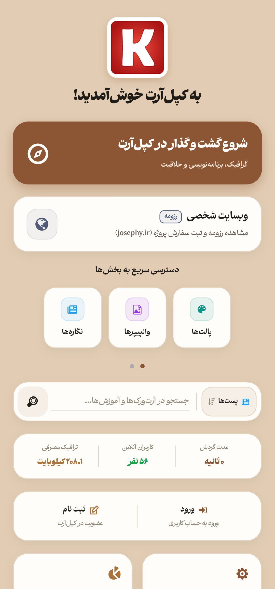
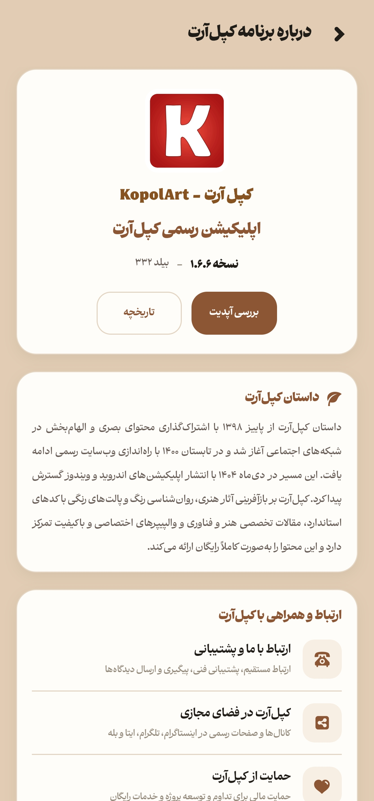
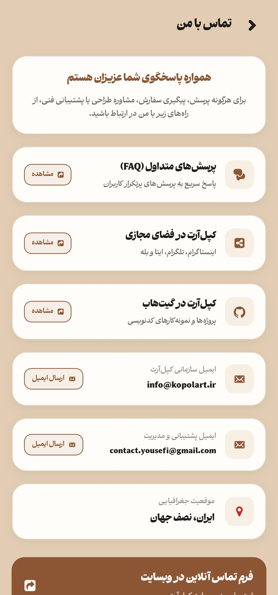

<div align="center">


# KopolArt for Android

**Colors, palettes, wallpapers and articles from [kopolart.ir](https://kopolart.ir) — in a fast, native-feeling Persian app.**


[**Download the APK**](https://github.com/kopolart/kopolart-android/releases/latest) ·
[Website](https://kopolart.ir) ·
[Report a bug](https://github.com/kopolart/kopolart-android/issues)

</div>

---

## Screenshots

| Dashboard | Wallpaper preview | Downloads | Gesture guide |
| :---: | :---: | :---: | :---: |
|  |  |  |  |
| A live dashboard with quick access, online users, traffic and session stats | Crop for home screen, lock screen or both, then apply instantly | Every file you saved, with size, path, re-download and set-as-wallpaper actions | Long-press actions, double-tap to return, swipe to manage lists |

<details>
<summary><b>More screenshots</b></summary>
<br />

| | | | |
| :---: | :---: | :---: | :---: |
|  |  |  |  |

</details>

## What is this?

KopolArt is a Persian platform for graphic design, programming and visual creativity. This repository is the **Android client** — a native shell built with .NET MAUI around the KopolArt experience, designed so the site feels like an app rather than a page in a mobile browser.

The client is not a thin browser tab. It brings its own dashboard, library, download manager, offline reader, wallpaper engine, widgets and update pipeline, and talks to `kopolart.ir` for content.

> This repository contains the **client only**. The website, backend, APIs, artwork, photography and written content are not part of this project and are not licensed here.

## Features

### Browsing
- Native shell with persistent navigation, smooth transitions and a fast dashboard
- Full site experience with in-page **find**, text selection and long-press page actions
- Smart **search** with suggestions across posts, colors, palettes and wallpapers
- Recent-search chips that remember how you work

### Library
- **Bookmarks** with inline editing
- **History** grouped by day, with swipe-to-delete and quick actions
- **Download manager**: pause, resume and cancel, progress notifications and a configurable destination folder
- **Offline pages**: save complete pages with embedded images and fonts so they still look right without a connection
- **RSS reader** for following new posts

### Wallpapers
- Built-in preview with home screen / lock screen / both modes
- Apply a wallpaper without leaving the app
- Desktop-sized and phone-sized wallpaper downloads

### Personalisation
- Light and dark themes that follow the system
- Category colour palettes used consistently across screens
- Persian-first interface, right-to-left layout and Persian digits
- **Home screen widget** with a quick entry point to KopolArt

### Utilities
- **Backup and restore** of bookmarks, history, downloads, settings and search history
- **In-app updater** that downloads and installs new versions
- Usage insights: session time, pages visited, network traffic, online users, milestones and achievements
- New-content notifications and throttled background checks through WorkManager
- Share-target support (`kopolart-share:`) and standard Android sharing

## Under the hood

```
KopolArt.Mobile/
├── Platforms/Android/     Native integrations: widget, wallpaper, WorkManager,
│                          notifications, JS bridge, typeface cache
├── Views/ ViewModels/     MVVM screens and their presentation logic
├── Services/              Bookmarks, history, downloads, offline pages, RSS,
│                          updates, backup, analytics, milestones
├── Helpers/               Offline rendering, fonts, gestures, formatting
├── Models/                Serialization models and view data
└── Resources/             Fonts, images, styles, raw assets
```

- **.NET 11 + .NET MAUI**, single Android target, `net11.0-android37.0`
- **MVVM with dependency injection** (`Microsoft.Extensions`) and a thin UI layer
- **Native first**: Android APIs are reached through small platform services instead of leaking into shared code
- **Offline fidelity**: page assets and fonts are inlined so saved pages render exactly like the site
- C# nullable enabled, trimming enabled for release builds, no third-party UI framework

## Install

1. Open the [latest release](https://github.com/kopolart/kopolart-android/releases/latest).
2. Download `ir.kopolart.app.apk`.
3. Allow installation from your browser/file manager when Android asks, then install.

Requires **Android 10 (API 29) or newer**, arm64 or armv7.

## Build from source

Requirements: .NET 11 SDK, Android SDK, and the MAUI Android workload.

```bash
git clone https://github.com/kopolart/kopolart-android.git
cd kopolart-android

dotnet workload install maui-android
dotnet build KopolArt.Mobile/KopolArt.Mobile.csproj -f net11.0-android37.0 -c Release
```

### Release signing

No keystore and no password is stored in this repository. To produce a signed APK, create
`KopolArt.Mobile/KopolArt.Mobile/signing.local.props` from
[`signing.local.props.example`](KopolArt.Mobile/KopolArt.Mobile/signing.local.props.example),
or set these environment variables:

| Variable | Purpose |
| --- | --- |
| `KOPOLART_KEYSTORE_PATH` | Absolute path to your `.keystore` file (keep it outside the repo) |
| `KOPOLART_SIGNING_PASSWORD` | Keystore and key password |

Without them the build still works, but the resulting APK is unsigned and will not install.

### Fonts

The published source ships **Estedad** (SIL Open Font License 1.1). If the commercial **Abar** family is present in `Resources/Fonts` locally, the build switches to it automatically via the `KOPOLAR_FONT_ABAR` define — no code changes needed. The Abar files are intentionally excluded from this repository because their license does not permit redistribution.

## Version

| | |
| --- | --- |
| Version | 1.6.6 |
| Version code | 332 |
| Application ID | `ir.kopolart.app` |
| Min SDK | Android 10 (API 29) |

Full release history and APK downloads live in [Releases](https://github.com/kopolart/kopolart-android/releases).

## License

Source code: [MIT](LICENSE).

The MIT license covers **code only**. The KopolArt name, logo, wordmark, colour identity, artwork, photography, content and the `kopolart.ir` service are **not** licensed. See [NOTICE](NOTICE) before reusing anything beyond the source files.

## Acknowledgements

- [Estedad](https://github.com/aminabedi68/Estedad) — OFL 1.1
- Icon font generated with IcoMoon; Font Awesome Free glyphs are CC BY 4.0
- [.NET MAUI](https://github.com/dotnet/maui) and the .NET team

---

<div dir="rtl">

## دربارهٔ کپل‌آرت

**کپل‌آرت** یک اپلیکیشن اندروید برای سایت [kopolart.ir](https://kopolart.ir) است؛ مرجعی فارسی برای گرافیک، برنامه‌نویسی و خلاقیت. این برنامه فراتر از یک مرورگر ساده است: داشبورد اختصاصی، مدیریت دانلود، ذخیرهٔ صفحات برای مطالعهٔ آفلاین، تنظیم والپیپر، ابزارک صفحهٔ اصلی، پشتیبان‌گیری از داده‌ها و به‌روزرسانی درون‌برنامه‌ای در آن تعبیه شده است.

- طراحی راست‌به‌چپ و فارسی، با پشتیبانی از تم روشن و تاریک
- نصب: فایل APK آخرین نسخه را از بخش Releases دریافت کنید (اندروید ۱۰ به بالا)
- این مخزن فقط کد کلاینت اندروید است؛ محتوا، تصاویر و سرویس سایت جزء آن نیستند.

</div>
